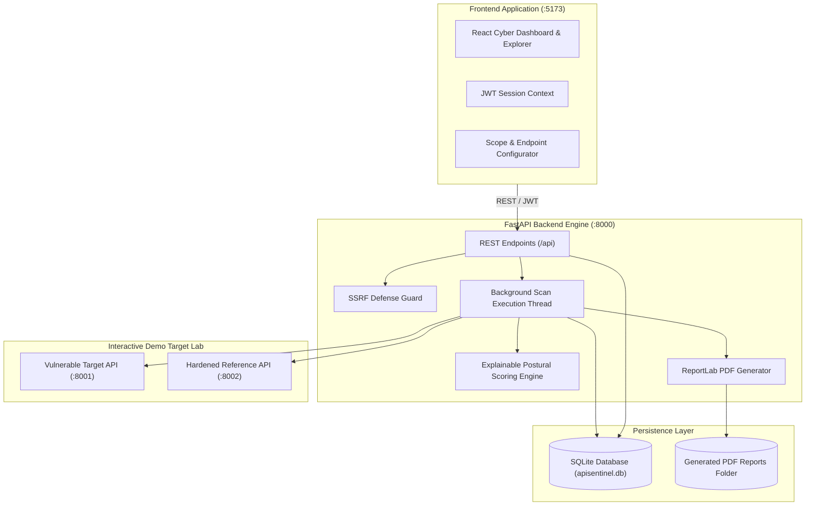

# API Sentinel — API Security Assessment & Vulnerability Detection Platform

API Sentinel is an enterprise-grade cybersecurity platform built to identify security weaknesses in REST APIs through automated, non-destructive security assessments following the **OWASP API Security Top 10**.

---

## 1. Problem Statement & Motivation

Modern software architectures rely extensively on REST APIs for cloud applications, microservices, mobile apps, and third-party integrations. However, APIs are now the primary attack vector for data breaches, account takeover, and unauthorized resource access. 

Manual penetration testing cannot scale with rapid CI/CD deployments, while traditional web application vulnerability scanners often fail to understand API structures, JSON payloads, stateful authentication tokens, and Object-Level Authorization boundaries.

**API Sentinel** solves this problem by delivering:
- An automated assessment engine tailored specifically for REST APIs.
- Dedicated modules for Broken Object Level Authorization (BOLA/IDOR), authentication bypasses, sensitive data leakage, and rate limiting.
- Non-destructive security checks that evaluate API boundaries safely without causing denial-of-service or database corruption.
- An explainable, severity-weighted security scoring system (0–100) and board-ready downloadable PDF reports.

---

## 2. Key Features

- **Authentication & User Isolation**: JWT-based session management, Bcrypt password hashing, and user-isolated scopes.
- **API Target Management**: Register target base URLs, configure HTTP methods (`GET`, `POST`, `PUT`, `DELETE`, `PATCH`), custom headers, authentication schemes (Bearer, API Key, Basic), request timeouts, and pre-scan connectivity verification.
- **SSRF & Safety Guardrails**: Built-in SSRF protection blocking cloud metadata IP ranges (`169.254.169.254`, Google/AWS/Azure metadata hosts) and requiring explicit user authorization.
- **Modular Security Scanner Engine**:
  1. **BOLA / IDOR (OWASP API1:2023)**: Cross-account authorization boundary comparison using dual test account tokens and resource ID tampering detection.
  2. **Broken Authentication (OWASP API2:2023)**: Detects endpoints accessible without credentials, improper handling of expired/forged tokens, and signature bypasses.
  3. **Excessive Data Exposure (OWASP API3:2023)**: Recursively audits JSON payloads for exposed credentials, SSNs, credit card patterns, private keys, and internal IDs.
  4. **Rate Limiting Assessment (OWASP API4:2023)**: Controlled request bursts analyzing HTTP 429 throttling and missing `X-RateLimit-*` / `Retry-After` headers.
  5. **Safe Injection Probing (OWASP API8:2023)**: Safe syntax error checks identifying database driver exception leaks (SQLite, PostgreSQL, MySQL, Mongo) without destructive payloads.
  6. **Security Misconfiguration (OWASP API8:2023)**: Checks for wildcard CORS policies (`Access-Control-Allow-Origin: *` with credentials), technology disclosure banners (`Server`, `X-Powered-By`), verbose stack traces, and enabled `TRACE` methods.
  7. **HTTP Security Headers**: Detects missing `Strict-Transport-Security` (HSTS), `Content-Security-Policy` (CSP), `X-Content-Type-Options`, `X-Frame-Options`, and `Referrer-Policy`.
  8. **Input Validation**: Evaluates error handling and type strictness on unexpected parameters and malformed JSON payloads.
- **Explainable Security Scoring (0–100)**: Transparent posture score calculation with documented severity-weighted deductions.
- **Centralized Vulnerability Explorer**: Filter by severity, category, target, and triage status (`Open`, `Resolved`, `Accepted Risk`).
- **Interactive Scan Comparison**: Side-by-side delta analysis between scans showing score differences, remediated vulnerabilities, and new findings.
- **Executive PDF Report Generation**: Multi-page formatted PDF security reports built using ReportLab with executive summaries, severity distribution tables, detailed evidence summaries, and remediation recommendations.
- **Self-Contained Demo Security Laboratory**: Includes both an intentionally vulnerable mock banking API (`:8001`) and a hardened reference API (`:8002`) for reproducible proof-of-concept testing.

---

## 3. Technology Stack

### Frontend
- **Framework**: React 19 + TypeScript (Vite 8)
- **Styling**: Tailwind CSS v4 (Cybersecurity Dark Operations theme)
- **Icons**: Lucide React
- **Visualizations**: Recharts (Bar, Area, and Distribution charts)
- **HTTP Client**: Axios with JWT request/response interceptors

### Backend
- **Framework**: Python 3.11+ / FastAPI
- **Data Validation**: Pydantic v2
- **ORM & Database**: SQLAlchemy with SQLite (structured for zero-code migration to PostgreSQL)
- **Authentication**: Bcrypt + PyJWT (HMAC-SHA256)
- **Network Engine**: Python Requests with thread-safe session pools
- **Reporting**: ReportLab 5.0

---

## 4. System Architecture



---

## 5. Security Posture Scoring Formula

The security score is calculated using an explainable, deterministic mathematical model:

$$\text{Security Score} = \max\left(0.0, \, 100.0 - \sum (\text{Severity Count} \times \text{Weight})\right)$$

### Severity Weights:
| Severity Level | Deduction Weight | Example Vulnerabilities |
| :--- | :--- | :--- |
| **Critical** | **-25.0 points** | BOLA / IDOR, Missing Authentication, Token Bypass |
| **High** | **-15.0 points** | Credential Exposure, Insecure CORS Wildcard, SQL Exception Leak |
| **Medium** | **-7.0 points** | Missing Rate Limiting, Missing HSTS, Verbose Stack Trace |
| **Low** | **-3.0 points** | Server Banner Disclosure, Missing CSP or X-Frame-Options |
| **Informational** | **0.0 points** | Missing Referrer-Policy, Security Best Practice Suggestions |

### Posture Classification:
- **90 – 100**: Grade A (Excellent Defensive Posture)
- **75 – 89**: Grade B (Good Baseline Security)
- **50 – 74**: Grade C (Moderate Risk / Action Advised)
- **30 – 49**: Grade D (Poor / High Risk)
- **0 – 29**: Grade F (Critical / Severe Risk Exposure)

---

## 6. Installation & Quick Start

### Prerequisites
- Python 3.11+
- Node.js v18+ and npm

### 1. Clone & Set Up Backend

```bash
# Clone the repository
git clone https://github.com/your-org/api-sentinel.git
cd api-sentinel

# Install backend dependencies
pip install -r backend/requirements.txt
```

### 2. Set Up Frontend

```bash
cd frontend
npm install
npm run build
cd ..
```

---

## 7. Running the Platform

For full functionality, open 4 terminal windows (or run as background processes):

### Terminal 1: Vulnerable Demo API Target (:8001)
```bash
python demo-lab/vulnerable-api/app.py
```
*API docs available at `http://127.0.0.1:8001/docs`*

### Terminal 2: Hardened Secure Demo API (:8002)
```bash
python demo-lab/secure-api/app.py
```
*API docs available at `http://127.0.0.1:8002/docs`*

### Terminal 3: API Sentinel Backend Server (:8000)
```bash
cd backend
python -m uvicorn app.main:app --host 127.0.0.1 --port 8000 --reload
```
*Swagger UI documentation available at `http://127.0.0.1:8000/docs`*

### Terminal 4: API Sentinel Frontend Client (:5173)
```bash
cd frontend
npm run dev
```
*Access web console at `http://127.0.0.1:5173`*

---

## 8. Demonstration Walkthrough (Proof-of-Concept)

To demonstrate the full assessment and remediation workflow:

1. **Register & Log In**:
   - Navigate to `http://127.0.0.1:5173/register` and create an analyst account.
2. **Auto-Register Demo Targets**:
   - Go to **Settings & Lab Guide** (`/settings`) and click **"1-Click Register Demo Targets"**.
   - This automatically creates pre-configured entries for both `InsecureBank (:8001)` and `SecureBank (:8002)`.
3. **Execute Scan on Vulnerable API**:
   - Go to **API Targets** (`/targets`) and click **Scan** on `InsecureBank Demo Target (Vulnerable)`.
   - Confirm the authorization checkbox and click **Start Assessment**.
   - Watch real-time progress on the live scanner monitor.
   - **Expected Result**: Score drops to **0 – 25 / 100 (Grade F)**. Detections include BOLA, Missing Auth on `/orders`, Password Hash/SSN Exposure, Missing Rate Limiting, Missing HSTS/CSP, and SQLite Error syntax leaks.
4. **Generate PDF Report**:
   - On the results page, click **"Download PDF Report"** to export an executive assessment report.
5. **Execute Scan on Secure Reference API**:
   - Return to **API Targets** and scan `SecureBank Reference API (Hardened)` (`:8002`).
   - **Expected Result**: Score elevates to **80 – 100 / 100 (Grade A/B)** with zero critical authorization bypasses, rate limiting enforced (429), and sanitized responses.
6. **Compare Assessments**:
   - Go to **Scan Comparison** (`/scans/compare`), select Scan 1 and Scan 2, and review the **+50 to +75 point posture improvement** and list of resolved vulnerabilities.

---

## 9. Running Automated Tests

Run the comprehensive pytest suite covering password hashing, JWTs, SSRF validation, scoring formula, data exposure traversal, PDF report compilation, and live demo scans:

```bash
# Run unit and integration tests
python -m pytest tests/test_api_and_scanner.py -v

# Run full live end-to-end demo lab test (requires servers on 8000, 8001, 8002)
python -m pytest tests/test_live_demo_scans.py -s
```

---

## 10. Security & Ethical Testing Disclaimer

API Sentinel is strictly intended for authorized security audits, developer defensive QA, and academic cybersecurity research. 

- **Authorization Requirement**: Never scan any API target without documented, explicit authorization from the system owner.
- **Non-Destructive Testing**: All security checks use safe, rate-bounded probes. Destructive testing, database extraction, and denial-of-service tests are explicitly out of scope.
- **SSRF Defense**: The scanner blocks cloud metadata addresses (`169.254.169.254`) by default to prevent internal network pivot abuse.

---

## 11. License

This project is developed under the MIT License for educational and cybersecurity research purposes.

